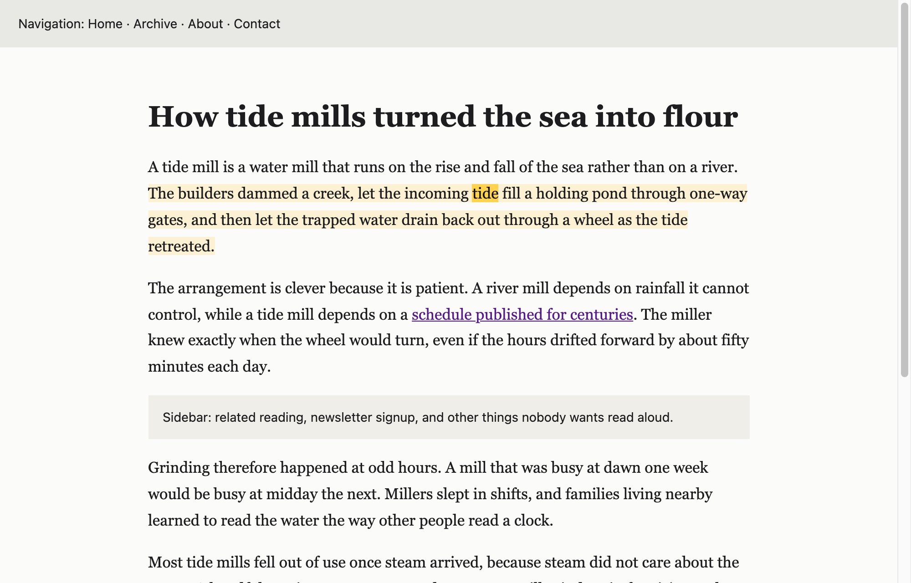
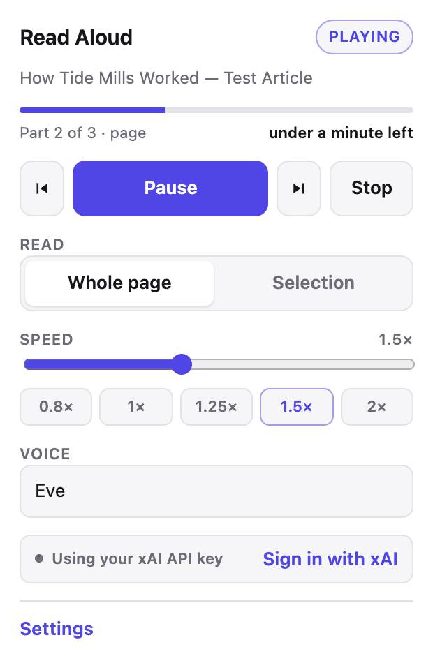
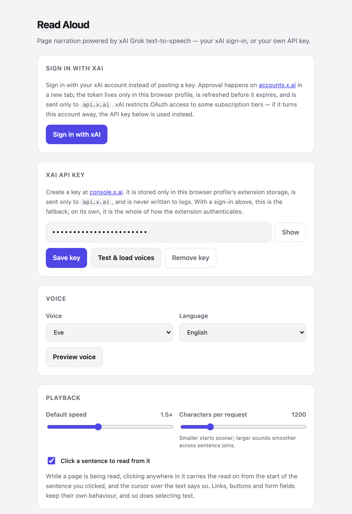

# Read Aloud (Grok TTS)

Paste this into your coding agent to install it:

```markdown
Install the Read Aloud (Grok TTS) Chrome extension for me on this Mac.

Repository: https://github.com/guyberger/grok-read-aloud.git

1. Check that `git` and `node` (v18 or newer) are installed. Clone the
   repository to `~/grok-read-aloud`, or `git pull` there if it already exists.
   There is nothing to `npm install`.
2. Before writing anything outside the clone, ask me: "Can I build the
   extension into ~/Library/Application Support/grok-read-aloud/chrome, or do
   you want to run the commands yourself?" Say why that folder: Chrome loads
   unpacked extensions slowly from ~/projects and home folders on these Macs,
   and from Application Support the popup opens instantly.
   - If I say yes, run:
     `cd ~/grok-read-aloud && node tools/build.js --only chrome --out "$HOME/Library/Application Support/grok-read-aloud"`
   - If I want to do it myself, give me that exact command and wait for me.
   Either way, confirm `~/Library/Application Support/grok-read-aloud/chrome/manifest.json` exists.
3. Tell me how to load it. Chrome won't open `chrome://` links from other
   apps, so tell me to paste `chrome://extensions` into the address bar, then:
   - Turn on **Developer mode** (top right).
   - Click **Load unpacked**, press **Cmd+Shift+G**, paste
     `~/Library/Application Support/grok-read-aloud/chrome`, press Return,
     then click **Select**.
   - Pin it from the puzzle-piece menu in the toolbar.
   - On the options page that opens (or the card's **Details → Extension
     options**), click **Sign in with xAI**, or paste an API key from
     https://console.x.ai and click **Save key**. Then click **Allow on all
     sites** under Site access and accept Chrome's prompt, so it is always on.
```

A Chrome extension that reads the page, or your selection, aloud with xAI's
Grok voices and highlights each word as it is spoken.



<p>
  
  
</p>

## Install

Use the prompt above, or do it by hand on a Mac with git and Node 18+:

1. Clone the repository (URL in the prompt above) and `cd` into it.
2. `node tools/build.js --only chrome --out "$HOME/Library/Application Support/grok-read-aloud"`
3. Paste `chrome://extensions` into the address bar, turn on **Developer mode**,
   click **Load unpacked**, press **Cmd+Shift+G**, paste
   `~/Library/Application Support/grok-read-aloud/chrome` and click **Select**.
4. On the options page, sign in with xAI or save an API key, then click
   **Allow on all sites**.

Build into Application Support, not your checkout: from `~/projects` Chrome
takes about a second to open the popup. Firefox and the other build folders are
covered in [docs/DEVELOPMENT.md](docs/DEVELOPMENT.md#install).

## Use it

- **Start:** click the toolbar icon and press **Read page**, or pick
  **Selection** first to read only what you selected.
- **Pause and stop:** the same button pauses and resumes. **Stop** ends the
  read and forgets the position.
- **Speed:** drag the slider or pick a preset, from 0.5× to 3×. The pitch stays
  the same at every speed.
- **Move around:** the ◀ and ▶ buttons step a sentence back or forward, and
  clicking any sentence in the page while it is playing reads from there.
- **Keys:** there are no extension shortcuts. The keyboard's play/pause key,
  headphone buttons and the system's media controls all work, even with the tab
  in the background.

Only one tab reads at a time, and a page you left part-read continues where you
stopped. Voice, language, default speed and highlighting are on the options
page.

## Development

```bash
npm run verify   # lint and secret scan, unit tests, build
npm run dev      # rebuild dist/chrome on every change; a dev build reloads itself
```

The end-to-end check drives a muted headless Chrome against a mock API, so it
needs no key. Start the mock, the fixture server and Chrome as in
[Running the end-to-end check](docs/DEVELOPMENT.md#running-the-end-to-end-check),
then:

```bash
node tools/build.js --only chrome-test --out /tmp/ra-build
node tools/e2e.js --extension /tmp/ra-build/chrome-test
```

How it works, the design notes, the manual checklist and the known limits
(sign-in can be gated by xAI's subscription tier, so keep a key handy) are in
[docs/DEVELOPMENT.md](docs/DEVELOPMENT.md).

## License

MIT
