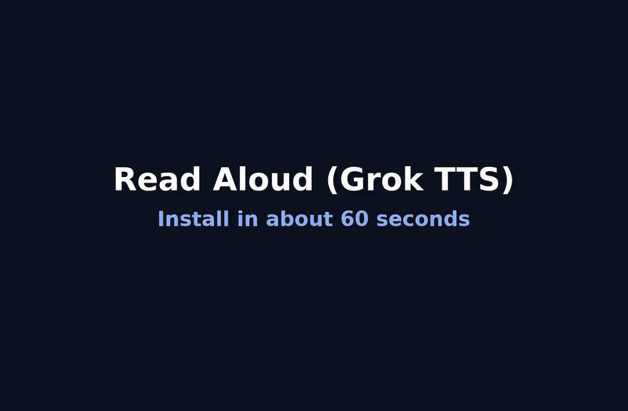
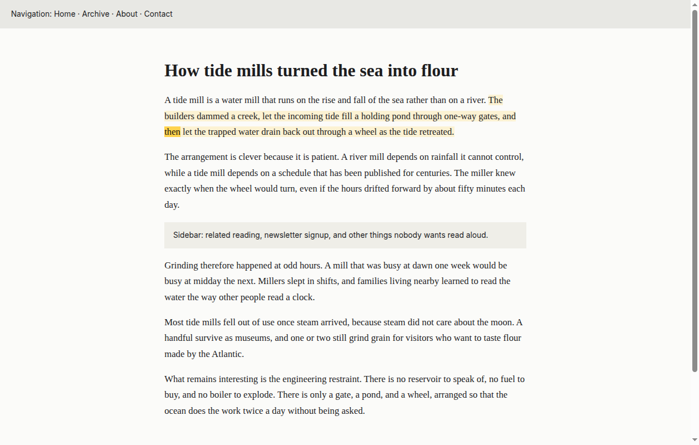
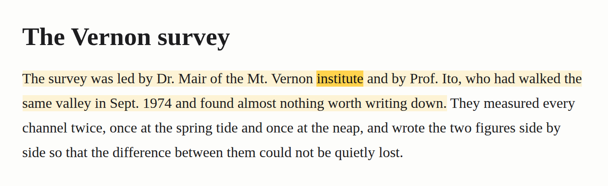
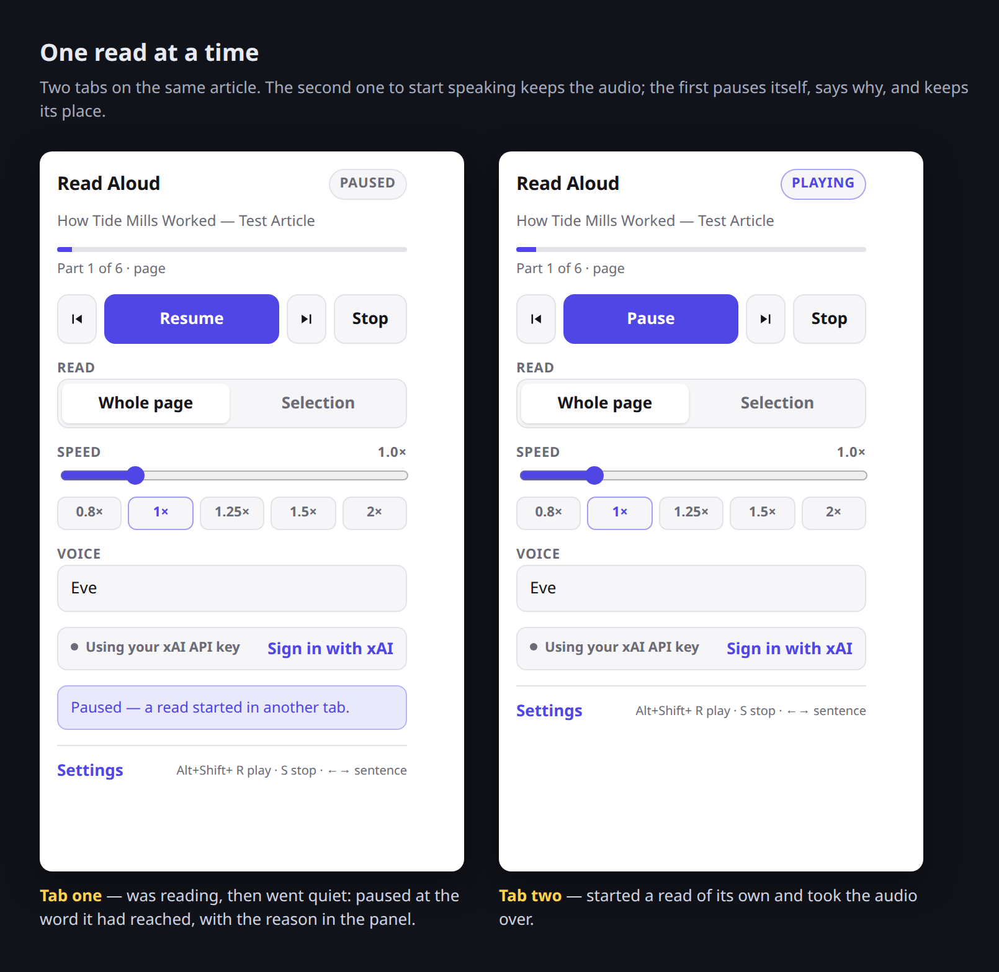
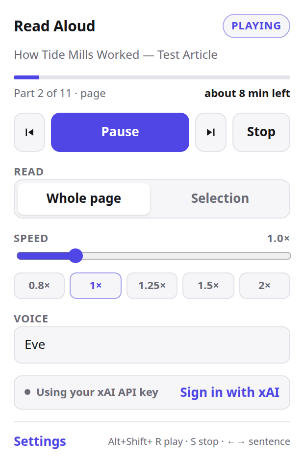
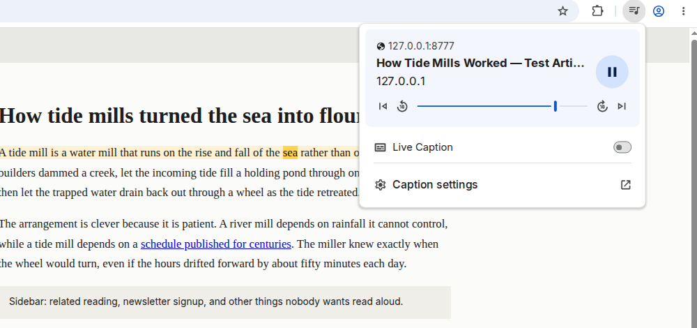

# Read Aloud (Grok TTS)

A personal browser extension that reads the current page — or just the text you
selected — out loud using xAI's Grok text-to-speech API, highlighting each word
as it is spoken.

## Install in 60 seconds

[](docs/install.mp4)

*The same take at full size and full speed: [docs/install.mp4](docs/install.mp4)
(1:29). It is recorded against this repository's own mock API —
`tools/mock-api.js` — so the key typed into the options page is the placeholder
the tests use, not a real one.*

1. **Clone it and build it.** The build copies `src/` into one folder per
   browser, so git, Node and npm are the whole of what it needs.

   ```bash
   git clone https://github.com/guyberger/grok-read-aloud.git read-aloud
   cd read-aloud
   npm ci          # a no-op — the lockfile describes an empty dependency tree
   npm run build   # writes dist/chrome, dist/firefox and dist/chrome-test
   ```

2. **Open `chrome://extensions`** and turn on **Developer mode**, top right.
3. **Click Load unpacked** and choose the **`dist/chrome`** folder — that one,
   not `dist/chrome-test`, which is the same build with `<all_urls>` held
   outright for the end-to-end driver.
4. **Pin it.** Click the puzzle-piece icon in the toolbar, then the pin beside
   **Read Aloud (Grok TTS)**.
5. **Give it a credential.** The options page opens by itself on first install:
   either click **Sign in with xAI**, or paste a key from
   [console.x.ai](https://console.x.ai), click **Save key**, then
   **Test & load voices** — which reports how many voices are available.
6. **Read something.** Open an article, click the toolbar icon, press
   **Read page**. The spoken word is highlighted as you hear it.

Firefox, and what each of the three build folders is for: [Install](#install).



One source tree builds an unpacked extension for both Chrome (Manifest V3) and
Firefox (Manifest V3). There is no backend, no build toolchain, and no runtime
dependencies — just the files in `src/` and a ~40-line copy script.

## What it does

- Reads the readable body of a page, skipping navigation, sidebars, footers,
  forms, code blocks and anything hidden with CSS.
- Reads just the current selection instead, when you ask it to.
- Reads the code written into a sentence — a setting name, a flag, a file path
  — because a sentence without it says something else. Whole snippets are
  skipped by default, and there is a setting for those.
- Highlights the spoken word, tints the sentence around it, and scrolls to keep
  up — driven by the per-character timestamps the API returns, not by guesswork.
- Says how long there is left to listen, measured against the audio the API is
  actually returning rather than guessed from a word count — and in the time
  the speed you are reading at will take, not the length of the recording.
- Jumps to any sentence you click while it is reading, from its first word, and
  carries on from there.
- Keeps the audio it has already fetched for as long as the page is open, so
  going back through a page, or reading it again, replays what is in hand
  instead of buying the same sentences twice.
- Steps back and forward a sentence at a time, so a few words you missed take
  one key press to hear again — a sentence being a whole one, so `Dr. Mair` and
  `Sept. 1974` are not three of them.
- Remembers where you left off on a page, so coming back to it carries on from
  there instead of from the top — and asks for the audio from there, so the
  part you already heard is not paid for twice.
- Reads in one tab at a time: starting a read somewhere else pauses the tab that
  was reading, rather than two voices talking over each other.
- Play, pause, resume and stop from the popup or a keyboard shortcut — or from
  the play/pause key on a keyboard, a headphone button, or whatever the system
  shows for the thing currently making sound, all of which work with the tab in
  the background. If something outside the extension pauses the audio, the read
  pauses with it rather than claiming to still be playing.
- Speed control from 0.5× to 3×, applied instantly without re-synthesising.
- Splits long pages into chunks at paragraph and sentence boundaries, and
  fetches the next chunk while the current one plays, so playback does not stall
  between parts.
- Opens with one short request — a sentence or two — so it starts speaking in
  about a second, and grows the chunks from there.
- Authenticates either by signing in with your xAI account or with an API key,
  and falls back from the first to the second when xAI turns the sign-in away.

## How it talks to the API

Requests go straight from the extension's background worker to
`https://api.x.ai/v1/tts`. **No proxy or local helper is needed.** The API
answers CORS preflights from any origin, including `chrome-extension://…`:

```
$ curl -i -X OPTIONS https://api.x.ai/v1/tts \
    -H "Origin: chrome-extension://abcdefghijklmnopabcdefghijklmnop" \
    -H "Access-Control-Request-Method: POST" \
    -H "Access-Control-Request-Headers: authorization,content-type"

HTTP/2 200
access-control-allow-origin: *
access-control-allow-headers: *
access-control-allow-methods: *
```

Real responses carry `access-control-allow-origin: *` as well, and the preflight
explicitly permits the `Authorization` header, so a browser will not strip it.
The extension also declares `host_permissions` for `api.x.ai`, which lets the
background worker bypass CORS entirely — so the request path works for two
independent reasons.

Each chunk is one `POST /v1/tts` with `with_timestamps: true`, which changes the
response from raw audio bytes to a JSON envelope:

```json
{
  "audio": "<base64 audio>",
  "content_type": "audio/mpeg",
  "duration": 0.92,
  "audio_timestamps": {
    "graph_chars": ["H", "e", "l", "l", "o", " ", "w", "o", "r", "l", "d", "."],
    "graph_times": [[0.0, 0.06], [0.06, 0.12], "…"]
  }
}
```

`graph_chars` mirrors the submitted text one character at a time and
`graph_times` is the parallel array of `[start, end]` spans in seconds. The
extension sends `text_normalization: false` so that mirroring stays exact, walks
the two arrays to get a time span per character, groups characters into words,
and maps each word back to a DOM range. That is what makes the highlight land on
the right word rather than drifting.

Audio is requested as MP3 at 24 kHz / 64 kbps — the bitrate the API documents as
good for speech — which keeps each chunk small enough to pass cheaply between
the worker and the page.

The `Authorization: Bearer …` header is the same either way: an API key and an
OAuth access token from a sign-in go in the same place, so nothing below the
choice between them has to know which one it was handed. That includes TTS,
which is the only thing this extension asks for.

## Install

[Install in 60 seconds](#install-in-60-seconds) is the Chrome path end to end,
in six steps and a video. This is the same ground with the parts a video cannot
hold still for.

Either browser starts with the same three commands:

```bash
git clone https://github.com/guyberger/grok-read-aloud.git read-aloud
cd read-aloud
npm run build
```

Nothing is downloaded and nothing is installed first: the committed
`package-lock.json` describes an empty dependency tree, so `npm ci` succeeds as
a no-op and can be skipped entirely. The build copies `src/` and swaps in the
right `manifest.json`, which it does three times:

| Folder | What it is |
| --- | --- |
| `dist/chrome` | The Chrome build — **this is the one to load.** |
| `dist/firefox` | The Firefox build: `background.scripts` and a gecko id. |
| `dist/chrome-test` | The Chrome build with `<all_urls>` held outright, for `tools/e2e.js` and nothing else — see [Running the end-to-end check](#running-the-end-to-end-check). |

### Chrome

The steps are the ones in the video above. Two things it does not hold still
long enough to say:

- The options page opens by itself on first install, and only then — it is the
  install with no key and no sign-in already in the profile that opens it. If it
  does not appear, reach it from the extension's **Details → Extension
  options**.
- A loaded unpacked extension survives restarting Chrome, so this is a one-time
  install rather than something to redo each session. Rebuilding over the same
  folder needs the card's **Reload** on `chrome://extensions` to take effect.

### Firefox

Firefox only keeps a manually loaded extension until the browser restarts, which
is fine for personal use.

1. Open `about:debugging#/runtime/this-firefox`.
2. Click **Load Temporary Add-on…**.
3. Select `dist/firefox/manifest.json` (the manifest file itself, not the
   folder).
4. Open the add-on's preferences from `about:addons` to reach the options page.

Firefox 128 or newer is required, because the background script is an ES module.

In Firefox, host permissions declared in a Manifest V3 extension are not granted
at install time. The options page has a **Grant access to api.x.ai** button that
asks for it in one click; you can also enable it from `about:addons` →
**Read Aloud** → **Permissions**. Requests generally work even without it,
because the API allows cross-origin calls, but granting it is the reliable path.

The extension declares exactly two hosts — `api.x.ai` for the API and
`auth.x.ai` for the sign-in — and `npm run check` fails if a manifest ever
declares a third. `accounts.x.ai`, where a sign-in is approved, is only ever
opened in a tab, which needs no permission at all.

## Sign in

There are two ways to authenticate, and the extension works with either one.
Both end up as the same `Authorization: Bearer …` header on the same requests
to `api.x.ai`.

### Sign in with xAI

1. Open the extension's options page.
2. Click **Sign in with xAI**. A tab opens on `accounts.x.ai` with the sign-in
   already identified by a code; the options page shows the same code in case
   the page asks for it.
3. Approve it there. The options page switches to **Signed in with xAI** on its
   own — you do not have to come back to it first.
4. Pick a voice and click **Preview voice** to hear it.

**xAI gates this by subscription tier.** Signing in can succeed and the API can
still answer 403 to the token it produced; see
[Known limits](#known-limits). When that happens the extension falls back to
the API key if one is set, and says in the popup that it did.

**Sign out** removes the tokens from this browser and asks xAI to revoke the
grant.

### Use an API key instead

1. Create a key at [console.x.ai](https://console.x.ai).
2. Open the extension's options page.
3. Paste the key and click **Save key**.
4. Click **Test & load voices** — it should report how many voices are
   available, and fill the voice picker with the live list from
   `GET /v1/tts/voices`.
5. Pick a voice and click **Preview voice** to hear it.

A key on its own is the whole of how the extension authenticates, exactly as it
was before sign-in existed. Alongside a sign-in it is the fallback.

### Where the credentials live

Both the key and the OAuth tokens are written to `browser.storage.local`, which
is scoped to that browser profile. Neither is logged — `npm run check` fails if
anything in `common/xai-auth.js` or `common/credentials.js` so much as calls
`console`, which is the only reliable way to keep a token out of the worker's
devtools. The key never leaves the background worker: page-side code is handed
everything *except* it, and the status the popup and options page read has no
token in it at all. Nothing in this repository contains a credential, and
`npm run check` fails the build if anything shaped like a key or a signed JWT is
ever committed.

### Which one a request uses

| State | What a request to `api.x.ai` carries |
| --- | --- |
| Signed in, no key | The OAuth access token |
| Key, not signed in | The key, unchanged from before sign-in existed |
| Both | The OAuth token; the key catches it if xAI turns it away |
| Signed in but gated, with a key | The key, with a notice in the popup saying why |
| Signed in but gated, no key | Nothing — the popup explains the gate |
| Neither | Nothing — the popup says what is missing |

A **401** is read as a token this extension let go stale: it costs one forced
refresh and one more attempt before it counts as a rejection. A **403** is the
tier gate, which refreshing cannot lift, so it falls straight through to the
key — and the extension stops leading with the sign-in until some later request
succeeds, rather than paying for a 403 on every chunk of a long page.

## How the sign-in works

The device authorization grant, [RFC 8628](https://www.rfc-editor.org/rfc/rfc8628),
against `auth.x.ai`. Approval happens in a browser tab rather than on a
redirect back into the extension, which is what makes it usable here: an
extension has no stable loopback port to be redirected to.

1. `POST https://auth.x.ai/oauth2/device/code` with the client id and scopes
   returns a `device_code`, a `user_code`, and the URL to approve at.
2. The worker opens that URL in a tab and polls
   `POST https://auth.x.ai/oauth2/token` with
   `grant_type=urn:ietf:params:oauth:grant-type:device_code`.
   `authorization_pending` means wait; `slow_down` means wait a second longer.
3. Approval turns the next poll into an access token and a refresh token.
4. From then on the token is refreshed five minutes before it expires.

The polling lives in the background worker, not in the page that started it:
the popup closes the moment the approval tab takes focus, and the sign-in has
to survive that. Each poll is a `fetch`, which is what keeps the worker from
being shut down mid-flow. Signing in again while one is already in flight shows
the code that flow already has rather than stranding it.

### The values, and where they came from

Every value is hard-coded from a public source rather than discovered at
runtime, so the extension declares one extra host permission instead of
trusting whatever a discovery response names.

| Value | Source |
| --- | --- |
| `https://auth.x.ai` issuer | `auth.x.ai/.well-known/openid-configuration` |
| `/oauth2/device/code`, `/oauth2/token`, `/oauth2/revoke` | the same document's `device_authorization_endpoint`, `token_endpoint`, `revocation_endpoint` |
| `urn:ietf:params:oauth:grant-type:device_code` | listed in its `grant_types_supported` |
| Scopes `openid profile email offline_access grok-cli:access api:access` | all listed in its `scopes_supported`; this exact set is what Hermes Agent's `xai-oauth` provider sends |
| No client secret | `token_endpoint_auth_methods_supported` includes `none` |
| Client id `b1a00492-073a-47ea-816f-4c329264a828` | **Hermes Agent's**, not ours — see below |

`common/xai-auth.js` has a `verifyEndpoints()` that re-checks the first five
against the live document, for when the question is whether they have drifted.

The client id is the one value that is not ours to have. xAI publishes no way
to register an OAuth client, and the device-code endpoint rejects an
unregistered one, so there is no id of our own to use yet — this is the one
[Hermes Agent](https://hermes-agent.nousresearch.com/docs/guides/xai-grok-oauth)
registered, which is the only published client of this flow. It means xAI sees
this extension as Hermes. It is a single named constant in `common/xai-auth.js`
and should be replaced the moment xAI offers registration.

`offline_access` is the scope that buys the refresh token and `api:access` is
the one the bearer needs to reach `api.x.ai`; losing either silently breaks a
different half of this, so `npm test` asserts both are still asked for.

## Use it

- **Popup** — click the toolbar icon, choose **Whole page** or **Selection**,
  then click the read button. The same button becomes Pause and Resume.
- **Alt+Shift+R** — start reading, or pause/resume if already reading. With text
  selected it reads the selection; otherwise it reads the page.
- **Alt+Shift+S** — stop.
- **Alt+Shift+←** / **Alt+Shift+→** — back a sentence, or on to the next one.
  The same two steps are the ◀ and ▶ buttons either side of the read button in
  the popup.
- **The media keys** — while a page is being read, the play/pause key on a
  keyboard, the button on a pair of headphones, and the media panel the
  browser and the operating system show all drive the read: play, pause, stop,
  and previous/next for a sentence either way. They say which page is being
  read, and unlike the shortcuts above they do not need the tab focused.
- **About *n* min left** — next to the part count, how much listening is left
  at the speed currently set. Moving the speed slider moves it.
- **Click anywhere in the text** while it is reading to carry on from the
  sentence you clicked, starting at its first word. The audio stops where it
  was and picks up there. It works while paused too, and starts playing again
  from there. While a read is running the cursor over the text being read is a
  pointer, so you can see where this works; links, buttons and fields keep
  their own behaviour, selecting text by dragging still selects, and a click
  outside the text being read does nothing.
- **Continue page** — when a page was left part-read, the popup says how far in
  it got and the read button continues from there. **Start over** next to it
  goes back to the top.

Pressing back part-way through a sentence reads *that* sentence again, since
that is where the words you missed are. Press it again at the start of one and
it goes to the sentence before it.

Anything else that pauses the audio — a call taking over the sound, headphones
unplugged, a video started in the same tab — pauses the read too, keeping its
place, so carrying on is one press of whichever control you have to hand.

Only one tab reads at a time. Start a read in a second tab and the first one
pauses, keeping its place and saying why; resuming it takes the read back and
quietens the second.

**Stop** is the control that finishes with a page: it resets the popup to Ready
and forgets the position. Pausing, closing the tab and a failed request all keep
it — those are reads that were interrupted rather than ended.

Rebind any of these at `chrome://extensions/shortcuts`, or in Firefox under
`about:addons` → the gear menu → **Manage Extension Shortcuts**.

By default the extension can only touch a page at the moment you invoke it, via
`activeTab`. That means the keyboard shortcut works, but only on the tab that is
focused when you press it. If you would rather it be able to act on any page
without that handshake, the options page has an **Allow on all sites** button
that requests the broader permission; **Revoke** takes it back.

### Settings

| Setting | Default | Notes |
| --- | --- | --- |
| Voice | `eve` | Live list from the API, with a built-in fallback list |
| Language | `en` | 20 languages plus `auto` detection |
| Default speed | 1.0× | Applied to the audio element, so pitch is preserved |
| Characters per request | 1200 | The size chunks settle at; the first one or two are smaller regardless, so a read starts quickly |
| Click a sentence to read from it | on | Only plain clicks on the text being read, and only while one is running |
| Read code blocks aloud | off | Whole snippets. Code inside a sentence is read either way |
| Follow the spoken word | on | Scrolls only when the word leaves a comfortable band |
| Tint the current sentence | on | |
| Highlight colour | amber | Text colour adapts for contrast automatically |

## Manual test checklist

With a credential saved and the article at `tests/fixtures/article.html` open
(or any article you like):

**Setup**
- [ ] Options page opens by itself the first time the extension is installed.
- [ ] **Test & load voices** reports a voice count and fills the picker.
- [ ] **Preview voice** plays audio and reports a duration.
- [ ] Changing the voice and reloading the options page keeps the new choice.

**Signing in with xAI** — against the real `auth.x.ai`, which the end-to-end
checks cannot do
- [ ] **Sign in with xAI** opens `accounts.x.ai` in a tab and shows a user code.
- [ ] Approving there flips the options page to **Signed in with xAI** without
      you touching it, and the popup's credential row agrees.
- [ ] Closing the options page mid-flow and reopening it shows the same code
      still waiting, and approving still completes.
- [ ] Reading a page works with no API key saved at all.
- [ ] If xAI answers 403, the popup says the account is gated rather than
      looping on a retry — and with a key saved, the read still works and the
      popup says the key was used instead.
- [ ] **Sign out** returns the options page to **Sign in with xAI**, and a read
      falls back to the key with nothing to explain.
- [ ] With both signed out and no key, the popup says what is missing.

**Opening the popup**
- [ ] It appears straight away, complete, with no part of it blank and no
      moment where the panel is one size and then another.
- [ ] Opened while a page is being read — and especially on a heavy page — it
      says **Playing** with a live transport from the moment it is on screen,
      rather than **Checking…** over four dead buttons.
- [ ] Opened on a tab that has since been reloaded, it never claims a read that
      is over.

**Reading a page**
- [ ] Clicking **Read page** starts audio in about a second.
- [ ] The first sentence or two run into the rest without a gap.
- [ ] Exactly one word is highlighted at a time, and it matches what you hear.
- [ ] The sentence around the spoken word carries a lighter tint.
- [ ] The page scrolls to follow the highlight, without fighting you when you
      scroll manually.
- [ ] Navigation, sidebar and footer text is never read or highlighted.
- [ ] Hidden (`display: none`) text is never read.
- [ ] Audio continues smoothly across a chunk boundary — watch the "Part *n* of
      *m*" label in the popup tick over without a long gap.

**How long is left**
- [ ] A read under way says *about n min left* next to the part count.
- [ ] The figure falls as the read goes on, including across a part boundary.
- [ ] Moving the speed to 2× roughly halves it, straight away.
- [ ] It is still there while paused, and gone once **Stop** is pressed.
- [ ] Left open for a couple of minutes, the panel's figure has gone down.
- [ ] On a short page it says *under a minute left* rather than counting
      seconds down.

**Transport**
- [ ] **Pause** stops the audio and freezes the highlight.
- [ ] Resuming continues from the same word.
- [ ] **Stop** clears the highlight completely and resets the popup to Ready.
- [ ] Moving the speed slider changes the pace immediately, mid-sentence.
- [ ] `Alt+Shift+R` and `Alt+Shift+S` do the same as the popup buttons.

**The browser's own media controls** — the part no automated check can press
- [ ] While reading, the page appears in the browser's media panel (Chrome:
      the ▶ button in the toolbar) named after the page, with the site under it.
- [ ] The play/pause key on the keyboard pauses and resumes the read, with the
      tab in the background and the popup closed.
- [ ] Previous and next in that panel step a sentence back and forward.
- [ ] Pausing from the panel shows **Paused** in the popup, not Playing over a
      frozen highlight; resuming from the popup moves the panel back.
- [ ] Starting a video in another tab pauses the read, and the popup says
      Paused.
- [ ] **Stop** takes the entry out of the panel; a page with a player of its own
      is left with its own entry once the read has stopped.

**Stepping a sentence**
- [ ] ▶ moves to the first word of the next sentence without a gap.
- [ ] ◀ part-way through a sentence starts that sentence again.
- [ ] ◀ at the start of a sentence goes back to the one before it.
- [ ] Both work while paused, and start playing again from the new position.
- [ ] Both buttons are greyed out with nothing being read.
- [ ] ▶ on the last sentence of the page does nothing rather than erroring.
- [ ] `Alt+Shift+←` and `Alt+Shift+→` do the same as the two buttons.

**Where a sentence ends** — with `tests/fixtures/abbreviations.html` open
- [ ] The first sentence is read straight through: `Dr. Mair`, `Mt. Vernon`,
      `Prof. Ito` and `Sept. 1974` carry no pause and no falling cadence.
- [ ] The tint covers the whole sentence, not `The survey was led by Dr.`
- [ ] One press of ▶ from the top of that paragraph reaches `They measured`,
      not `Mair`.
- [ ] `He said "Not at this tide, not for anyone."` is tinted as one sentence,
      closing quote included, and the sentence after it is tinted separately.
- [ ] Nothing is read twice or skipped where a part boundary falls.

**Picking up where you left off**
- [ ] Read a few paragraphs of a long page, pause, close the tab, reopen the
      page: the popup says how far in it got and the button reads **Continue
      page**.
- [ ] Clicking it carries on from about where it stopped, not from the top.
- [ ] **Start over** reads from the top, and the offer to continue is gone.
- [ ] **Stop** clears the offer; the next read starts from the top.
- [ ] Hearing a page to the end clears it too.
- [ ] A page only a sentence or two in is not offered — it reads from the top.
- [ ] Reading a **Selection** leaves the page's own position alone.

**One read at a time**
- [ ] Start a read, open a second article in another tab and read that: the
      first tab goes quiet, and its popup says a read started in another tab.
- [ ] Resuming the first tab carries on where it paused, and the second tab
      pauses with the same explanation.
- [ ] Neither tab loses its place in the handover, and neither re-reads from
      the top.
- [ ] A read that fails on its credentials in a second tab does not silence the
      tab that is reading.

**Code on the page** — with `tests/fixtures/inline-code.html` open
- [ ] The first sentence is read as "set autoCommit to false", with the
      highlight landing on `autoCommit` itself.
- [ ] Neither the `{ "scheduleCron": … }` block nor the `rotateSecrets` line is
      read or highlighted.
- [ ] Turning **Read code blocks aloud** on and reading again speaks both, and
      the "Part *n* of *m*" count goes up.
- [ ] With the setting off, selecting the snippet alone and reading
      **Selection** reads it.
- [ ] Selecting two paragraphs with the snippet between them reads the prose
      and skips the snippet.

**Audio already paid for**
- [ ] Read several parts into a page, then click a word in its first paragraph:
      it starts speaking immediately, with none of the pause a fresh request
      takes.
- [ ] **Stop**, then read the same page again: it starts instantly and runs
      through the parts you already heard without a gap at any boundary.
- [ ] Change the voice and read again: it is the new voice from the first word,
      and the part boundaries still run together.
- [ ] Reload the page and read it again: that one does wait for a request, which
      is the point at which the audio is let go.

**Selection**
- [ ] Select two sentences, choose **Selection**, read: only the selected text is
      spoken and highlighted.
- [ ] Reading stops at the end of the selection instead of running on.
- [ ] While a selection is being read, clicking outside it does nothing.

**Clicking to jump**
- [ ] While reading, the cursor over the text being read is a pointer, and over
      the navigation and the footer it is not.
- [ ] Click the middle of a sentence further down the same paragraph: playback
      continues from the *first word of that sentence*, with no pause, and the
      tint moves with it.
- [ ] Click a sentence near the end of a long article: it starts there within a
      second or two and carries on.
- [ ] Click a sentence behind the playhead: it goes back to its start.
- [ ] Pause, then click a sentence: it jumps there and starts playing again.
- [ ] Click a link in the article: the link opens, and playback does not move.
- [ ] Select some text by dragging: playback does not move.
- [ ] Clicking navigation, the sidebar or the footer does nothing.
- [ ] **Stop**, then click the text: nothing moves, and the pointer cursor is
      gone.
- [ ] Turn **Click a sentence to read from it** off mid-read: clicks stop moving
      playback and the pointer cursor goes with them.

**Failure handling**
- [ ] With no credential at all, the popup says what is missing rather than
      failing silently.
- [ ] With a deliberately wrong key, the popup shows that the key was rejected.
- [ ] On a page you have not clicked yet, if audio is blocked, both the page and
      the popup say to click the page once — and clicking it starts playback.
- [ ] On `chrome://extensions` or another internal page, the popup explains that
      the page cannot be read instead of appearing to hang.

## Development

```bash
npm run build     # write dist/chrome, dist/firefox and dist/chrome-test
npm run check     # parse every script, validate manifests, scan for secrets
npm test          # unit tests for chunking and timestamp alignment
npm run verify    # all three
npm run icons     # regenerate the PNG icons from tools/make-icons.js
```

There is nothing to install: the committed `package-lock.json` describes an
empty dependency tree, and exists only so that `npm ci` succeeds as a no-op
instead of failing for want of a lockfile.

Everything here is checked on Node 22. `npm run build` is plain ESM and
`fs.cpSync`, so Node 18 is enough to install the extension; `npm test` hands
`node --test` a glob, which wants Node 21 or newer to expand.

`npm test` covers chunking, timestamp alignment, the API client's error
handling, content extraction, the mapping from a click to a word, a chunk and a
time, the device-code sign-in, the rule for which credential a request goes
out with, finding a remembered position again in a page that has changed under
it, the claim that keeps one tab reading at a time, the line between code
written into a sentence and a snippet, the arithmetic behind how long a read
has left, what the read looks like on the browser's own media controls, and the
line between a pause the extension asked for and one that came from outside it.
The extraction, click, media-control and playback tests drive a headless
Chrome, because what counts as rendered, what is under a given pixel, which
media actions a browser has and when an audio element fires `pause` are the
browser's answers, and testing them against a stub would only test the stub.
They skip themselves where there is no Chrome; set `CHROME_PATH` to point at
one.

```bash
node tools/popup-paint.js --runs 20           # popup paint and load timings
node tools/popup-paint.js --runs 10 --cold 1  # with the worker stopped first
```

`tools/first-audio.js` measures the wait between pressing read and hearing
something. It needs the same Chrome and mock API as the end-to-end driver — see
[Running the end-to-end check](#running-the-end-to-end-check) — with the mock
started so that a request takes as long as a real one would:

```bash
node tools/mock-api.js --port 8443 --cert /tmp/cert.pem --key /tmp/key.pem \
  --latency-base 400 --latency-per-char 1.5 --latency-timestamps 150 &

node tools/first-audio.js --extension "$PWD/dist/chrome-test" --runs 5

# the same page read twice, the second time out of memory
node tools/first-audio.js --extension "$PWD/dist/chrome-test" --runs 5 --second-read 1
```

`--second-read 1` is the measurement behind [Audio already paid
for](#audio-already-paid-for): with the latency model above, the first read
waits about 800 ms for its opening chunk and the second waits about 12 ms for
no requests at all.

### Layout

```
src/
  manifest.chrome.json    Chrome MV3: service_worker background
  manifest.firefox.json   Firefox MV3: background.scripts + gecko id
  common/                 Settings, the API client, the xAI sign-in, the choice between credentials, and what the panel last knew
  background/             Holds the credentials, makes every network call, injects content scripts
  content/                Injected on demand; extraction, alignment, clicks, playback, the audio already fetched, highlighting, the cross-tab handoff, the browser's media controls
  popup/  options/        Extension UI
tools/                    Build, icons, static checks, mock API, end-to-end and timing drivers
tests/                    Unit tests and the fixture pages they read
```

The background worker is the only place the API key and the OAuth tokens exist.
Content scripts are injected on demand rather than declared for every URL, so
the extension never runs on a page you did not point it at.

### Picking the text to read

Only candidates the browser is actually rendering are scored. That matters on
sites that route in the client: those leave the previous page mounted and
hidden, and an index of every post holds more text than the one post on screen,
so an unfiltered score picks the stale copy and then finds nothing in it but
hidden nodes.

"Rendered" is decided by walking the ancestors and reading computed styles
rather than by `Element.checkVisibility`, which reports anything without a
layout box as invisible — including `display: contents` wrappers, whose
children render perfectly well and which component frameworks emit freely.

### Code in a page


`<code>` holds two different things, and reading them the same way is wrong
either way round.

A snippet is punctuation, indentation and symbols. Spoken aloud it is noise,
and it is billed by the character like everything else, so it is skipped —
which is what the extension always did.

Code written into a sentence is the opposite. `autoCommit` in *set `autoCommit`
to false before the first run* is the subject of the sentence. Dropping it
leaves "set to false", which is still a sentence, still reads fluently, and
says something else entirely. Nothing in the audio hints that a word went
missing. On a page of documentation — which is much of what this extension is
pointed at — that happened in most paragraphs.

So which one a `<code>` is gets decided by the page, not by the tag. A `<pre>`
is a snippet. Any other `<code>` is a snippet if the page lays it out as a
block and a phrase if it sits in the run of the text, which is the same
question, asked of the same computed styles, as whether an element is rendered
at all. That catches the `<code class="…">` block a site emits without a
`<pre>` around it, and it costs one style resolve per code element per read.

Two smaller rules round it off:

- **Read code blocks aloud** in the options brings the snippets back, for
  anyone who wants them. It is off by default.
- **A selection of nothing but a snippet is read regardless of that setting.**
  It is text the user picked out and pressed read on, and silence — or worse,
  falling back to reading the whole page — is not an answer to that. A
  selection that merely *contains* a snippet still skips it, like any other
  read.

### Why the popup paints before it knows anything

`popup.html` carries a complete default state, so the panel is whole on the
first paint without running a line of script. Stored settings, the cached voice
list and the reader's state are fetched afterwards and written into the panel
as each arrives. Reaching the reader is the slow part — it can mean starting
the background worker, injecting the content scripts, and waiting for a page
whose main thread is busy — and none of that is allowed between the click and
the panel.

`tools/popup-paint.js` measures it, and it measures two different things.

`--through-chrome 1` times the whole click: an extension page calls
`chrome.action.openPopup()`, which is what the toolbar button does, and the
clock runs from that call to the paint. Measured over 6 runs, median, in
headless Chrome 156:

| | Browser, before our document exists | Our paint | Click → paint |
| --- | ---: | ---: | ---: |
| This extension | 263 ms | 36 ms | **299 ms** |
| An extension whose entire popup is `<p>Control</p>` — no CSS, no script | 263 ms | 36 ms | **299 ms** |

The second row is `--control 1`, and it is the answer to "is the popup slow
because of us?". It is not. Nearly nine tenths of the wait is over before this
code exists: the browser has to build a popup window and a renderer to put the
document in, and it takes the same quarter of a second whether that document is
this panel or one line of HTML. The 36 ms after it is the paint pipeline, which
is also identical. Our own share — parsing `popup.html`, applying `popup.css`,
fetching and running `popup.js` — is the difference between the two load events,
about **3 ms**. Shutting the MV3 background worker down before every open
(`--cold 1`) changes none of it, because nothing is awaited on the worker before
the paint.

So the remaining work was never about milliseconds to paint; it was about what
the panel paints. The default mode measures that, and `--busy-page 1500` is the
case that shows it: a page whose main thread is tied up cannot be injected into
or answer a message, so the reader is a second and a half away.

| On a page that cannot answer for 1.5 s | Before | After |
| --- | ---: | ---: |
| First paint (within the document) | 84 ms | 80 ms |
| Popup shown (load event) | 11 ms | 12 ms |
| A state the panel was *told* on screen | 1498 ms | **15 ms** |
| The reader's own state on screen | 1498 ms | 1499 ms |
| Panel height moved after being shown | 5 runs of 5 | **never** |

Two changes got there.

**The panel opens on what was last known.** The worker writes the reader's
state down per tab, and which credential is in play once, in `storage.session`
— see `common/panel-cache.js`. The popup reads both on the way up, and neither
read touches the worker: `tabs.query` is answered by the browser itself and
session storage is held in memory, so they land in a millisecond or two. A
popup opened on a page already being read therefore says Playing, with a live
transport, instead of "Checking…" over four disabled buttons. `#status` carries
a `data-source` saying which of the two is on screen, and a remembered state can
never paint over the reader's own: the live answer wins whenever it arrives,
however late. The shelf is the right one for it — `storage.session` is cleared
when the browser closes, which is also when every remembered read stops being
true — and within a session the worker drops a tab's entry as soon as that tab
navigates, which is the other way a remembered read becomes a lie. Nothing
remembered is older than half a day, a read still `loading` is remembered as the
pause it will look like, and the text of an error is not remembered at all: it
was about one request at one moment.

**The panel is the size it will be.** A popup that grows after the browser has
sized its window appears and then moves. The credential row and the page title
are laid out from the first paint whether or not their content is known yet —
the row invisible until it has something to say, the title holding its one line
— so filling them in cannot resize a window that is already on screen.

### Highlighting without touching the page

Highlights use the CSS Custom Highlight API, which paints ranges without
inserting a single node into the page. The rules come from
`content/highlight.css`, injected with `scripting.insertCSS` so a strict page
Content-Security-Policy cannot suppress them. Where the Highlight API is
unavailable, the extension falls back to absolutely positioned overlay boxes
derived from the range's client rects — still without mutating the article.

### Time to first audio

Synthesis is per-character work, so the wait between pressing read and hearing
anything is set almost entirely by how much text the first request carries.
Everything the extension does locally — waking the worker, injecting the content
scripts, reading settings, extracting the article, cutting it into chunks —
measures **8–11 ms** together, on a page the content scripts have not been
injected into yet. There was never anything to win there.

So the first request is small: at most `FIRST_CHUNK_CHARS` (240) characters,
cut at a sentence boundary like any other chunk, which on real prose lands on
one or two sentences. From there each chunk doubles until it reaches the
**Characters per request** setting — 240, 480, 960, 1200 — so the opening is
quick and the body of the read still arrives in the large, smooth-sounding
pieces that setting asks for. The ramp restarts at every forced chunk boundary,
which means [jumping to a clicked sentence](#jumping-to-a-clicked-sentence) into text
that has not been fetched starts quickly for the same reason.

Two other things keep that opening from simply moving the wait to the first
join:

- The request for the chunk *after* the one being started goes out alongside
  it, rather than once it is playing. It then has the whole of the first
  chunk's synthesis time to arrive in.
- Opening the popup tells the worker a read is probably coming: it wakes, puts
  the settings in memory so the first synthesis does not wait on extension
  storage, and sends a keyless `OPTIONS` to `api.x.ai` so the first real
  request is a request rather than a TLS handshake.

`tools/first-audio.js` measures the result against the same Chrome and mock API
that the end-to-end driver uses, splitting the wait into the part before the API
sees anything, the API itself, and the part after. The API's real latency is not
published, so the mock models it as a fixed cost plus a per-character cost plus
a surcharge for `with_timestamps` — which the API documents as "adds latency for
the post-synthesis alignment pass". Measured over 4–5 runs per cell, median:

| First request | API model | Before | After |
| --- | --- | ---: | ---: |
| 1045 → 135 chars (`article.html`) | 400 ms + 1.5 ms/char + 150 ms | 2326 ms | **796 ms** |
| 1060 → 213 chars (`app-router-changelog.html`) | 400 ms + 1.5 ms/char + 150 ms | 2364 ms | **929 ms** |
| 1045 → 135 chars (`article.html`) | 400 ms + 4 ms/char + 150 ms | 4937 ms | **1132 ms** |
| 1060 → 213 chars (`app-router-changelog.html`) | 400 ms + 4 ms/char + 150 ms | 5002 ms | **1458 ms** |
| 1045 → 135 chars (`article.html`) | instant | 208 ms | 209 ms |

The last row is the point: with an API that answers instantly nothing changes,
because nothing was ever slow on this side. The win is whatever the API charges
per character, and it scales with that rate — which is why the per-character
figure is a parameter of the measurement rather than a number baked into it.

One caveat on the local half: the mock serves 24 kHz 16-bit WAV, about 48 KB per
second of speech, where the extension asks the real API for 64 kbps MP3, about
8 KB. The "response → audible" phase — moving the audio from the worker into the
page and decoding it — is therefore roughly six times pessimistic here. It fell
from 197 ms to 35 ms on the article anyway, since it scales with the same
number.

`optimize_streaming_latency` is deliberately not sent. It shrinks the first
*streamed* audio chunk at some cost to quality at chunk boundaries, and a unary
request is waited on whole, so it would buy nothing here.

### Jumping to a clicked sentence

A click is a pixel; playback is a time offset into one request's audio. Getting
from one to the other reuses the map extraction already built: the point becomes
a text node and offset (`caretPositionFromPoint`, falling back to
`caretRangeFromPoint`), the node and offset become an index into the extracted
string, the index snaps back to the start of the sentence it fell in, and that
character index finds the chunk holding it and, through that chunk's timestamps,
the moment it starts being spoken.

**The sentence, not the word.** A click is a rough gesture at a place in the
page, and what the listener is pointing at is a thought rather than the fifth
word of one. Starting mid-clause reads back as a fragment — "restraint. There is
no reservoir" — where the sentence from its beginning is what they were asking
to hear. It also agrees with everything else here: the tint covers a sentence,
[stepping](#stepping-a-sentence-at-a-time) lands on sentence starts, and chunks
are cut on [sentence boundaries](#where-a-sentence-ends) — so the start of a
sentence is very often a place this tab already has audio for, which makes the
commonest jump free as well as correct.

What happens next depends on what audio is already in hand.

| Where the sentence starts | What it costs |
| --- | --- |
| In the chunk playing now | A seek. No request, no wait. |
| In any chunk this page has already fetched | Load it and start at that sentence's own timestamp. No request. See [Audio already paid for](#audio-already-paid-for). |
| Anywhere else | One request, for a chunk that *begins* at that sentence. |

That last row is the interesting one, because the obvious alternative is to
fetch the chunk the sentence happens to fall inside and then seek within it.
That costs more on both counts that matter: the request carries the text before
it, which is billed and then skipped, and the audio takes longer to synthesise
and transfer for the same reason. So the chunk list is re-cut with a forced
boundary at the sentence first. Cutting is greedy from the start of each piece,
so everything more than one chunk ahead of the click comes out exactly as it
would have anyway — including the chunk being played, whose audio survives the
re-cut because the cache is keyed by character range rather than by chunk
number. Jumping into the end of a 1200-character chunk therefore asks for the
tail it is about to speak, not the 1100 characters it would have thrown away.

Requests the jump has made pointless are cancelled rather than left to land.
The page can only ask: the worker holds the key and therefore the `fetch`, so it
holds the `AbortController` too, and the page names the request it no longer
wants.

**Only while there is a read to move.** The listeners go on when a read starts
and come off when it ends, rather than sitting in every page the extension has
ever been invoked on: with nothing being read there is nothing for a click to
do, so there is no reason to be in the page's click path at all. `emit` is the
single place every state change passes through, so the listeners follow the
state instead of being switched on by hand at each of the half-dozen places a
read starts or stops. Turning the setting off mid-read takes them off too.

**The cue.** While a read is running, the cursor over the text being read is a
pointer. It is one `data-read-aloud-jump` attribute on the single element the
text was taken from, which `content/highlight.css` turns into a `cursor` rule —
so it inherits across the article and stops at its edges, and links, buttons and
fields keep the cursor they set for themselves. That attribute is the one thing
in here that touches the page rather than painting over it, which is why it is an
attribute rather than a node, why it is on one element rather than on the words,
and why it comes off the moment the read ends. A selection read gets no cue: the
clickable text is the selection, and marking the element it happens to sit
inside would promise the rest of that element too.

Only plain clicks on read text count. Clicks on links, buttons, inputs,
editable regions, anything with an interactive ARIA role, clicks carrying a
modifier, the second click of a double, right clicks, the click that ends a drag
and the click that leaves a selection behind are all left entirely alone — and
nothing in that path ever calls `preventDefault`, so a page that wants a click
keeps it. A click outside the text being read resolves to no character at all,
which is also what makes a selection read click only within its selection.

### Where a sentence ends



A full stop followed by a space is not a sentence ending, and a sentence
ending is not always a full stop followed by a space. Prose is full of both
mistakes waiting to be made:

| Written | A stop and a space says | What it is |
| --- | --- | --- |
| `led by Dr. Mair` | two sentences | one, with a title in it |
| `in Sept. 1974` | two sentences | one, with a date in it |
| `it cost approx. 400 pounds` | two sentences | one |
| `described on p. 112` | two sentences | one |
| `He said "Not at this tide." They waited.` | one sentence | two — the stop is inside the quote |

Three things read that answer, and all three are visible:

- **The tint** around the word being spoken, which is meant to be the clause
  you are in. On the first row above it covers `led by Dr.` and then jumps.
- **Stepping back and forward**, which should move a sentence per press. On
  that same row, back lands on a two-word fragment, so recovering the sentence
  takes two presses instead of one.
- **Where a chunk may be cut**, which is the one the listener actually hears.
  Chunk boundaries prefer sentence ends, so a chunk gets cut after `Dr.`, the
  API is handed text ending in `led by Dr.`, and it reads the title with a full
  stop in it — a falling cadence and a pause in the middle of a name. The next
  request opens on `Mair`, which it reads as the start of something.

So all three ask one predicate, and it is deliberately small:

- A sentence ends after the quotes and brackets closing over the terminator,
  not before them — `."`, `.)`, `?"`, `’.` — so the quote goes with the
  sentence it closes rather than opening the next one.
- A full stop is not an ending when the word before it is one letter standing
  on its own. That is one rule for every dotted form: the last stop of `U.S.`,
  `a.m.`, `e.g.` and `Ph.D.` all follow a single letter whose own predecessor
  is a stop, and the stops in `J. R. R. Tolkien` follow one letter after a
  space. A stop after a digit — `in 1999.` — is an ending, since no
  abbreviation ends that way.
- Otherwise it is an ending unless the word is on a list of about seventy:
  titles, reference shorthand, company suffixes, street words, months and days.
- A newline ends a sentence outright, whatever punctuation it carries, because
  a heading or a list item usually carries none.

The list is the part that can be wrong, so what is *not* on it matters as much
as what is. `etc.` and `No.` are absent on purpose: both finish sentences more
often than they sit inside one, so listing them would trade a rare mistake for
a common one.

### Stepping a sentence at a time

Stepping is the same move as clicking a word, aimed by the text instead of by
the pointer: the step resolves to a character index, and from there it is a seek
when the sentence is inside the audio already in hand, and a chunk that *begins*
at that sentence when it is not. So everything the jump path already does —
cancelling requests the step made pointless, re-cutting so the new request
starts on the first word rather than opening with text it would skip, resuming a
paused read — applies unchanged.

Two details are worth stating:

- **The sentences come from the whole extracted text, not from the chunk being
  played**, and they end where [a sentence
  ends](#where-a-sentence-ends) rather than at every full stop. A chunk's
  timeline only knows the sentences inside it, and a
  sentence that straddles a chunk join is cut in two there. Stepping over
  document-wide sentence ranges means a join is invisible to it, which is the
  point: the chunk boundaries are a billing and latency decision, and the
  listener should never meet them.
- **Back from the middle of a sentence re-reads that sentence.** Pressing back
  is how someone recovers a few words they missed, and those words are almost
  always in the sentence still being spoken — so only a sentence that has barely
  begun (under 1.5 s of audio, which is playback position rather than wall
  clock, so it holds at any speed) steps to the one before it. Pressing back
  twice therefore always reaches the previous sentence.

Stepping within a chunk — which is most steps, since a chunk is several
sentences — costs nothing at all, and nor does stepping back over a chunk join
into audio this page has already fetched. See [Audio already paid
for](#audio-already-paid-for).

### Picking up where you left off

A long page is rarely heard in one sitting, and starting it again from the top
costs the listener their place and the account the characters a second time. So
a whole-page read writes down where its playhead is — every five seconds, at
each chunk boundary, when it is paused, when the tab goes away, and when a
request fails — and the next read of that page continues from there.

Continuing is the same move as [clicking a sentence](#jumping-to-a-clicked-sentence):
the position is a character index, a chunk boundary is forced at it, and the
first request comes back *beginning* on the word about to be spoken rather than
carrying the part of the page already heard.

**What a position is remembered by is the text, not the index.** An index is
only true of the page as it was. A comment thread that grew, an advert that
expanded, a sentence the author fixed — and the same number now points into the
middle of a different word. So a position carries the 80 characters that were
about to be spoken, and finding it again is: trust the stored index if the text
there still matches, otherwise look for those characters and take the
occurrence nearest to where they used to be. A page edited above the position
therefore resumes exactly; a page edited *at* the position falls back to the
first 40 then 24 characters of the anchor; a page with none of it left starts
from the top, which is also what happens below 16 characters of match, where a
hit says too little to trust.

| What happens | The position |
| --- | --- |
| Pause, or close the tab, or follow a link | Kept |
| A request fails part-way through | Kept, so **Try again** carries on from the chunk that failed |
| **Stop** | Forgotten — the popup is back to Ready, and the page is done with |
| **Start over** | Forgotten, then read from the top |
| The page is heard to the end | Forgotten |

Two thresholds keep the offer from being noise. A position in the first 400
characters is not offered, because the opening of a page is quicker to hear
again than to decide about, and one in the last 3% is treated as a page that
was finished. A selection read leaves no position at all: it is about text the
user picked out, which may not be selected — or even be there — next time.

The store is one key in `browser.storage.local`, holding the 40 most recently
read pages and nothing older than a month, keyed by URL with the fragment
dropped so that a footnote link and the page it jumps back from are one page.
A position is a convenience, so every read and write of it swallows its own
failures: nothing about a read should break because storage would not answer.

That store is written several times a minute, which is why both the worker and
the reader now check *what* changed in storage before reacting. Treating a
position as a settings change would have dropped the worker's warm settings
copy — the one that keeps extension storage off the path of the next
synthesis — and sent the reader on a round trip to the worker for a value that
had not changed.

### One read at a time



Two tabs reading different pages over each other is not a feature anyone wants,
and the one nobody is listening to is still being billed by the character — so a
tab left reading behind a window you have moved on from is worse than useless.
When a read starts speaking, every other reader goes quiet.

The tabs arrange that between themselves. No tab can see another, and the
background worker cannot reliably message a tab that is not the active one —
`activeTab` is granted per gesture, and this extension asks for nothing broader
by default. What every injected content script *does* already have is the
extension's own storage area, and a listener on it. So the reader about to speak
writes its own id under one key, and every other reader hears that write and
pauses itself. A write also reaches *every* reader at once, including one left
over from a worker that has since been shut down and restarted.

Three details make it behave the way a listener would expect:

- **The claim is taken as the audio starts, not when read was pressed.** A read
  that never gets as far as a sound — no credential, a request that failed —
  silences nothing, so the tab that is working carries on.
- **The tab that spoke last keeps the read.** A read still fetching its first
  chunk is not interrupted by another tab starting, because it will claim the
  read for itself the moment it has audio. Whichever one that is, exactly one
  tab ends up speaking.
- **The other tab pauses rather than stops**, so it keeps its place and says
  why in the popup: *Paused — a read started in another tab*. Resuming it takes
  the read straight back, which silences the tab that had taken it. The
  explanation goes with the resume.

A claim is written once per handoff, not once per chunk: a reader that already
holds it writes nothing, so reading a long page is one write however many
requests it takes. Like a remembered position, a claim is a convenience — a
storage area that will not answer costs the handoff, never the read.

### How long is left



"Part 2 of 11" answers a question nobody asked. A part is a billing and latency
decision, its size changes when a jump re-cuts the chunks, and two of eleven
says nothing about whether this page fits in the walk to the station. The
question a listener has is *how much longer*, and the answer is a time.

Speech is per-character work at a roughly steady rate, so the time left is the
characters left times the seconds a character takes. That second number is not
guessed at for long: every chunk the API answers with reports its own
`duration`, so from the first one on the rate is measured against this voice,
this language and this page's own prose. It is averaged over every chunk so far
rather than taken from the last one, because a paragraph that happened to be
dialogue should not move the estimate for the twenty minutes after it. Until the
first chunk lands — a second or so — the figure comes from an assumed 15
characters a second, which is ordinary English narration.

Three things make the number behave:

- **The chunk being spoken is timed, not estimated.** Its audio is in hand and
  its duration came back with it, so what is left of it is known to the
  millisecond and only the text beyond it is multiplied out. The estimate is
  therefore exact over the next minute and approximate over the next twenty,
  which is the right way round.
- **Speed divides it.** The extension changes speed on the audio element rather
  than re-synthesising, so the same audio at 2× is the same speech in half the
  time — and the figure is the time you will spend, not the length of the
  recording. Moving the slider moves it immediately.
- **A panel left open counts down on its own.** The reader announces its state
  when something happens to it, not on a timer, because a message a second from
  every reading tab is exactly the traffic that keeps a background worker from
  ever being allowed to sleep. So the popup counts the seconds down itself and
  the next announcement — a chunk boundary, a pause, a jump — puts it right.

It is rounded to the minute, and under a minute it stops counting down at all:
a number ticking 50, 49, 48 is the part of a progress display nobody wanted.

### The browser's own media controls



Everything that pauses audio from outside a page — the play/pause key on a
keyboard, the button on a pair of headphones, the lock screen, the media panel
behind the toolbar — talks to it through one interface,
`navigator.mediaSession`. Nothing there needs the tab focused or the popup
open, which for something that talks for twenty minutes is the difference
between pausing it and hunting for the tab that is talking.

`src/content/controls.js` puts the read on those controls, and it is the only
part of the extension that writes to the page's media session. Four decisions
in it are worth stating:

- **Nothing is touched until a read starts.** The media session belongs to the
  page, which may have a player of its own. The extension takes it over when it
  is the thing actually speaking — the handlers go on with the audio player —
  and hands it back, handlers and metadata and all, when the read stops or the
  page goes away.
- **Each action is registered on its own.** A browser that does not know an
  action throws on it, and an unsupported `stop` must not take `pause` down
  with it. `tests/controls.test.js` asks a real Chrome which of them it accepts,
  because that is the one question a stand-in for the API cannot answer.
- **There is no seek bar.** A position slider would be measured against the
  audio element, which holds one chunk of a page rather than the page, so it
  would promise a position it cannot keep. Previous and next step a sentence
  instead, which is what those buttons are wanted for here anyway.
- **A chunk being fetched still shows pause.** `loading` is a read in progress,
  so the controls do not flip to a play button at every chunk join — which
  matches the popup, whose own button is held still while loading.

The other half is the one that is not optional. The media controls reach the
audio element directly, and so does anything in the system that takes audio
over; the element's events say *that* it was paused, never *who* paused it. Get
that wrong and the popup goes on saying Playing above a highlight that has
stopped moving. So `player.js` keeps the last thing it was asked for and treats
an event that disagrees with it as somebody else's:

```js
audio.addEventListener("pause", () => {
  if (wanted !== "playing" || audio.ended) return;
  wanted = "paused";
  onPausedOutside?.();
});
```

The `ended` half of that condition is load-bearing. Chrome fires `pause` when a
clip runs out, immediately before `ended` — so without it every chunk boundary
would look like an interruption and the read would stop after the first one
instead of advancing. `tests/player.test.js` drives a real element through a
real tone to hold all of it down: the extension's own pause and resume are not
reported, a pause on the element is, playing it again is, and running off the
end is the chunk ending rather than an interruption.

### Audio already paid for

A chunk of audio is one billed request and one wait. Once it has arrived it is
the most valuable thing a read owns — and the reader used to hold three of
them: the chunk being spoken and its two neighbours. Everything else was dropped
the moment the playhead moved on, so going back three paragraphs, or reading a
page a second time, bought the same seconds of speech again, and waited for them
again, when they had been in memory a moment earlier.

Now it is kept until memory says otherwise. `content/audio-cache.js` is a
least-recently-used store with its budget in bytes, because bytes are what the
tab has to hold: 24 MB, which at the 64 kbps the extension asks the API for is
a little under an hour of speech — more than any one page. A page that runs past
it loses the chunk that has gone longest unplayed, never the one about to be
spoken.

Audio is identified by the voice, the language and the character range, and the
text in that range is checked on the way back out. Each of those is there for a
reason:

- **The voice and the language**, because the same words in another voice are
  different audio. Keying on the range alone meant a chunk prefetched before the
  setting changed was played after it, so the next part of the page arrived in
  the voice you had just stopped using. Now a changed voice is a miss: the part
  being spoken finishes as it was synthesised, and the one after it is fetched
  in the new voice.
- **The character range rather than the chunk number**, because clicking into
  text nothing has been fetched for re-cuts the chunk list, and audio in hand
  has to survive the renumbering.
- **The text itself**, because a range is only an address. A page that rewrites
  itself under a read — a client-side route change, a comment thread that
  finished loading — leaves the same address naming different words, and audio
  that no longer matches is dropped rather than spoken over what is there now.

The store outlives a read, which is what makes Start over, a second read of the
same page, and a step back over a chunk join free rather than merely fast. It
does not outlive the document: a page that has gone cannot be read again, and
its audio is megabytes with nowhere to go.

What it deliberately does not do is persist. Audio in `storage.local` would
survive a reload and a browser restart, and it would also mean the extension
keeping a recording of every page anyone has had read to them, on disk,
indefinitely and silently. Memory for as long as the tab is open needs no such
explaining.

### Running the end-to-end check

`tools/e2e.js` drives a real Chrome over the DevTools Protocol and asserts that
the highlight walks the article in order, in time with the audio, and that
clicking a sentence moves playback to it — with the clicks dispatched through the
input pipeline, so the reader resolves real coordinates against real layout
rather than being handed an answer. It uses `tools/mock-api.js`, a stand-in for
the xAI API that mirrors the real endpoints, CORS headers and response envelope
but synthesises a placeholder tone — so the whole pipeline can be exercised
without spending a key. The mock also keeps a log of what it was asked to
synthesise, at `GET /debug/requests`, which is how the jump checks assert that a
jump cost one request beginning at the clicked sentence rather than several, or
one beginning earlier.

The checks for [jumping to a clicked
sentence](#jumping-to-a-clicked-sentence) click the fifth word of "What remains
interesting is the engineering restraint." — once into text nothing has been
fetched for, and once back into audio already in hand — and assert each time
that the request begins `What remains interesting`, that the highlight reaches
`What` before it reaches `engineering`, and that the tint is on that whole
sentence. All three are false of a jump that went to the word rather than to the
sentence. The cue is checked as a computed `cursor`: a pointer over the article
while a read is running, not a pointer over the navigation, and gone from both
when the read stops or the setting is turned off.

The checks for [picking up where you left off](#picking-up-where-you-left-off)
reload the page between the two reads, so the content scripts, the chunk list
and every byte of audio are gone and the second read has nothing to go on but
what the first one wrote down.

The checks for [code in a page](#code-in-a-page) read
`tests/fixtures/inline-code.html` from top to bottom and collect every word the
highlight lands on, which is the only way to assert a negative: no word of
either snippet is ever spoken, while `autoCommit` is — and the highlight on it
really is inside the `<code>` element rather than near it.

The checks for [where a sentence ends](#where-a-sentence-ends) read
`tests/fixtures/abbreviations.html` — prose with titles, dates, references and
quoted speech in it — with the chunks cut small, so the cuts land inside a
paragraph rather than on its newline, which is where the question arises. They
collect every tinted sentence and every request the mock was asked to
synthesise: no tint and no request may end on an abbreviation, the title and
the name after it must be tinted as one sentence, and a cut after a closing
quote must be one the chunker is willing to make. With the predicate reduced to
a full stop and a space, five of them fail, the tint arriving in pieces like
`The survey was led by Dr.` and a request going out ending `It cost approx.`

The checks for [how long is left](#how-long-is-left) sample the estimate across
a part boundary, which is the one place it could jump — it stops multiplying
one chunk out there and starts timing the next — and compare it against what
the mock's own audio implies for the text on the page.

The checks for [one read at a time](#one-read-at-a-time) open the article in a
second tab and drive both readers, which is the only way to see a handoff at
all: each assertion is about what the *other* tab did in response to this one
starting, and with the claim removed from the reader three of them fail with
both tabs reporting that they are playing.

The checks for [the browser's own media controls](#the-browsers-own-media-controls)
assert what the real extension writes into `navigator.mediaSession` on a real
page: that a page keeps its own session until a read starts, that a read then
appears there as playing and named after the page and the site, that pausing
and resuming move it, that the page is described once rather than at every
state change, and that stopping hands the session back. The buttons themselves
belong to the operating system and cannot be pressed over the DevTools
Protocol, which is why pressing them is a unit test against a stand-in.

The checks for [audio already paid for](#audio-already-paid-for) read several
parts into the article, click back into its opening, and then read the whole
page again from the top — asserting each time that the mock's request log grew
by nothing at all, so the audio came out of memory rather than off the API.
Changing the voice and reading again is the other half: those requests *must*
be made, and the mock records the voice each one asked for, so a check can tell
audio that had to be fetched again from audio that was merely replayed. Two
sections elsewhere reload the page before their own reads, because "a chunk that
has not been fetched" and "this request carried the OAuth token" are both claims
about a read that has to ask for audio at all.

The checks for [why the popup paints before it knows
anything](#why-the-popup-paints-before-it-knows-anything) open the panel while
the article is being read and assert on its *first* render rather than on what
it settles down to, with a watcher installed at document-start to catch it. One
of them ties the article's main thread up in a busy loop first, so the reader
cannot answer and the first render can only have come from what the worker
remembered — the panel says which, and the check asserts that too. The rest are
about the ways a remembered read stops being true: a tab that navigates is
forgotten, and a panel with nothing to go on renders at once and claims no read.

The sign-in checks run against the same mock, which also stands in for the
OAuth server and for the approval page on `accounts.x.ai` — approval in those
checks is a real click on a real button in a real tab, not something the driver
fakes. One process answers for all three hosts because the paths do not
collide: the API under `/v1`, the OAuth server under `/oauth2` and
`/.well-known`, and the approval page at `/oauth2/device`. Its tokens are
opaque strings prefixed `mock-oauth-`, which cannot be mistaken for anything
that works against the real API, and `GET /debug/oauth` reports what it has
issued so a check can assert a refresh happened without reading a token.

```bash
# 1. one certificate for all three hostnames the mock answers as
openssl req -x509 -newkey rsa:2048 -keyout /tmp/key.pem -out /tmp/cert.pem \
  -days 2 -nodes -subj "/CN=api.x.ai" \
  -addext "subjectAltName=DNS:api.x.ai,DNS:auth.x.ai,DNS:accounts.x.ai"
SPKI=$(openssl x509 -in /tmp/cert.pem -pubkey -noout \
  | openssl pkey -pubin -outform der | openssl dgst -sha256 -binary | openssl enc -base64)

# 2. the mock API and the fixture article
node tools/mock-api.js --port 8443 --cert /tmp/cert.pem --key /tmp/key.pem &
(cd tests/fixtures && python3 -m http.server 8777 --bind 127.0.0.1) &

# 3. Chrome, with all three xAI hosts pointed at the mock. Drop --headless=new
#    to watch.
google-chrome --headless=new --window-size=1000,800 \
  --user-data-dir=/tmp/ra-profile --enable-unsafe-extension-debugging \
  --host-resolver-rules="MAP api.x.ai 127.0.0.1:8443,MAP auth.x.ai 127.0.0.1:8443,MAP accounts.x.ai 127.0.0.1:8443" \
  --ignore-certificate-errors-spki-list="$SPKI" \
  --remote-debugging-port=9333 --autoplay-policy=no-user-gesture-required \
  http://127.0.0.1:8777/article.html &

# 4. the checks
npm run build && node tools/e2e.js --extension "$PWD/dist/chrome-test"
```

The driver loads `dist/chrome-test`, which is the Chrome build with `<all_urls>`
held outright. That is only so the driver can work: `activeTab` is granted by a
real user gesture, which the DevTools Protocol cannot produce. Everything else
about the build is identical, and the `activeTab` path is covered by the manual
checklist above.

Recent Chrome removed the `--load-extension` command-line switch, which is why
the driver loads the extension over the protocol instead.

## Known limits

- **Signing in with xAI may not get you through to the API.** xAI gates OAuth
  access to its API by subscription tier, and has been seen to answer `403 The
  caller does not have permission to execute the specified operation` to
  accounts whose in-app subscription is perfectly active
  ([Hermes Agent #26847](https://github.com/NousResearch/hermes-agent/issues/26847)).
  The sign-in itself succeeds, the tokens are real, and the API refuses them
  anyway. Nothing about this is fixable from here: signing in again changes
  nothing, which is why the extension does not suggest it. What it does instead
  is fall back to the API key when one is set, say so in the popup, and stop
  leading with the gated sign-in until a later request gets through. With no key
  set it fails with that explanation rather than a bare 403.

  So the API key is not legacy. For an account xAI gates, it is the only path
  that works, and it stays the documented one.
- **The sign-in borrows Hermes Agent's client id.** xAI publishes no client
  registration, so the extension identifies itself to `auth.x.ai` as the one
  published client of this flow. See
  [The values, and where they came from](#the-values-and-where-they-came-from).
  Practically this means the approval page names Hermes rather than Read Aloud,
  and that whatever rate limits or allowlists xAI applies per client are shared
  with every other Hermes user.
- **A sign-in in progress does not survive a browser restart.** Approval can
  take minutes, and the polling that waits for it lives in the background
  worker. Each poll is a `fetch`, which keeps Chrome from shutting an idle
  worker down, so an ordinary sign-in completes even with every extension page
  closed. A restart in the middle is the exception: the device code is still
  good at xAI, but nothing here is waiting on it any more, so the options page
  clears the stale prompt and the sign-in has to be started again.
- **Audio can need one click.** Browsers block audio that was not started by a
  gesture *on the page itself*, and clicking the toolbar popup does not count.
  When that happens the extension says so in both the page and the popup, and
  starts as soon as you click anywhere on the page. Chrome stops blocking a site
  once you have played audio there a few times. Routing playback through a
  Chrome offscreen document would remove the click on Chrome, but Firefox has no
  equivalent, so v1 keeps one shared path.
- **Where a sentence ends is decided by a list, so it can be wrong.** The
  rules in [Where a sentence ends](#where-a-sentence-ends) cover the dotted
  forms outright, but everything else is a list of about seventy abbreviations,
  and an unlisted one — a journal title, a language's own shorthand — is still
  read as the end of a sentence. The reverse happens too: a sentence that
  genuinely ends on a listed word (`…published by Acme Inc.`) or on a single
  letter (`…the grade was a B.`) is joined to the one after it. Nothing is
  misread either way; the cost is a tint that covers too much or too little,
  and a step that moves by two sentences or by half of one. The list is
  English, and a language that abbreviates differently gets the naive answer.
- **Readable-content detection is heuristic.** It looks for `<article>`,
  `[role=main]` and `<main>` first, then falls back to scoring text density,
  and if the winner yields almost nothing it reads the visible body instead,
  minus navigation, headers, sidebars and footers. On an unusual layout it may
  read too much or too little; selecting the text you want and reading the
  selection always works.
- **Whole code snippets are skipped by default**, on the grounds that
  punctuation and indentation rarely read well aloud. Code written into a
  sentence is always read — see [Code in a page](#code-in-a-page) — and
  **Read code blocks aloud** in the options turns the snippets on. Which of
  the two a `<code>` is comes from how the page lays it out, so a snippet in a
  `<code>` the page styles as inline is read as if it were a phrase.
- **No streaming.** Each chunk is one request that must finish before it can
  play. A short opening chunk cuts that wait to about a second (see
  [Time to first audio](#time-to-first-audio)), but it is still a wait, and it
  is still the largest thing between pressing read and hearing something.

  The API's bidirectional WebSocket endpoint (`wss://api.x.ai/v1/tts`) would
  remove it: audio comes back as `audio.delta` frames while the text is still
  being read, and — the part that decides whether it is usable here — each
  frame carries its own `audio_timestamps` and `audio_duration` when the
  connection is opened with `with_timestamps=true`. So the highlight could stay
  exactly as accurate as it is now, which is the one thing that cannot be
  traded away. It would also end chunk joins and the 60,000-character cap
  altogether.

  It is not implemented because it cannot be tested here. The protocol is
  documented precisely, but a client written to a document and checked only
  against a mock of that same document proves nothing about the real endpoint,
  and this repository has no key to check it against. Two further questions
  need answering first: whether `audio/mpeg` in MediaSource is dependable in
  both Chrome and Firefox, since a single shared playback path is the point of
  the current design, and whether WebSocket activity keeps a Firefox MV3
  background script alive the way it keeps a Chrome service worker alive. With a
  key and answers to those, this is the next change to make, and the transport
  is already behind one message in the worker.
- **How long is left is an estimate, and says so.** The chunk being spoken is
  timed exactly; everything after it is the characters left multiplied by the
  rate the chunks so far came back at. A page whose second half is one long
  table of numbers reads slower than its first half implies, so the figure
  drifts — and the first second or two of a read, before any chunk has
  answered, assumes a rate rather than knowing one. It is rounded to the minute
  for that reason.
- **Jumping into text that has never been fetched needs a new request.**
  Clicking a word whose audio this page has already fetched is instant, however
  far back it is — see [Audio already paid for](#audio-already-paid-for).
  Clicking well beyond the furthest the read has got costs one synthesis
  request — the same few seconds the first chunk costs — and re-cuts the chunks
  from that word, so the "Part *n* of *m*" label in the popup renumbers.
- **The audio is kept in memory, and only in memory.** It is not written to
  disk, on purpose, so a reload or a browser restart starts paying again — and
  a page longer than the 24 MB budget drops the parts it has gone longest
  without playing, so going back to the very top of one of those is a fresh
  request.
- **Speed above 1.5× is a playback-rate change**, not a re-synthesis. The API's
  own `speed` parameter tops out at 1.5× and would require re-fetching on every
  change, so the extension uses the audio element's rate, which preserves pitch.
  The Web Audio fallback path does *not* preserve pitch.
- **The media controls show one chunk, not the page.** Play, pause, stop and
  the two sentence steps are the extension's own; the position and duration
  beside them are the browser reading the audio element, which holds the chunk
  being spoken rather than the whole page. So that clock restarts at every
  chunk boundary, and the extension deliberately registers no seek action
  rather than appear to offer a page-wide scrub bar it cannot honour. The
  popup is where the page-wide figure lives — see
  [How long is left](#how-long-is-left). Chrome also only shows the panel once
  audio is genuinely playing, so it appears a second or so into a read rather
  than the moment read is pressed.
- **Shortcuts are tab-scoped by default.** With only `activeTab`, the keyboard
  shortcut acts on the focused tab at the moment you press it. Use **Allow on
  all sites** in the options if you want it unconditional.
- **One tab at a time.** Starting a read in a second tab pauses the first one
  rather than talking over it — see [One read at a time](#one-read-at-a-time).
  Two tabs can still be paused mid-read at once, each holding its own place.
- **Pages the browser protects** — `chrome://`, `about:`, the Web Store, other
  extensions' pages — cannot be read, and the popup says so.
- **Long pages cost real money.** Billing is per input character, and the whole
  page is sent in chunks. The API caps a single request at 60,000 characters;
  the extension stays far below that, but a very long article is still a lot of
  characters. What it will not do is bill you for the same characters twice
  within one visit to a page: everything already fetched is replayed from
  memory.

## License

MIT
